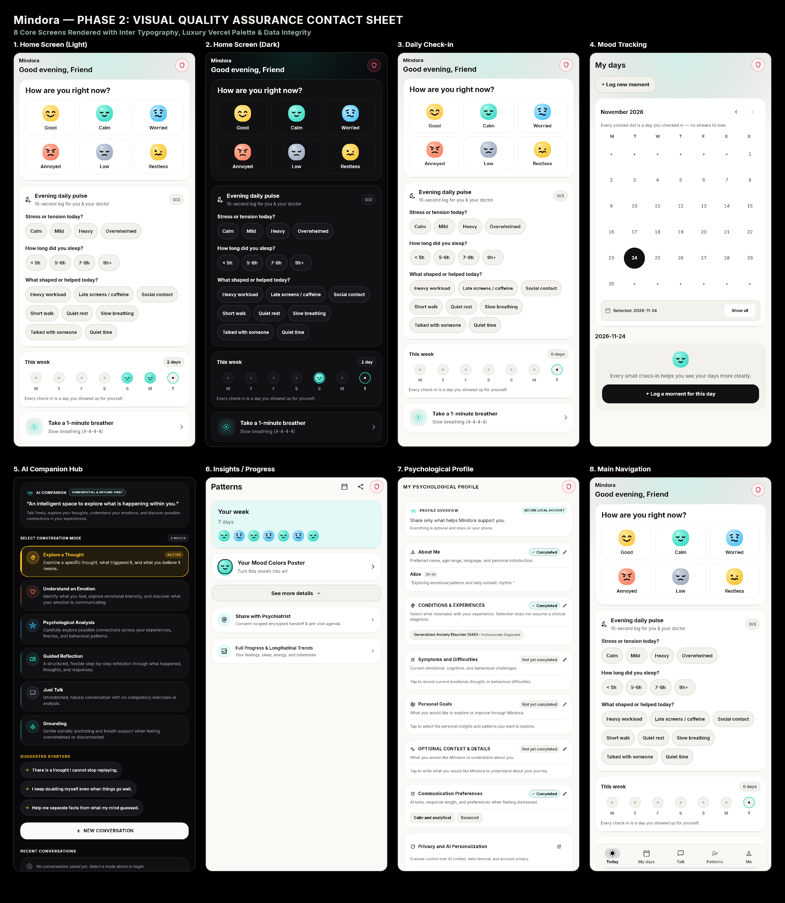
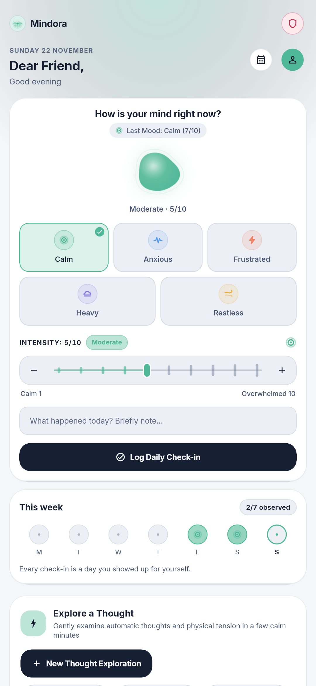
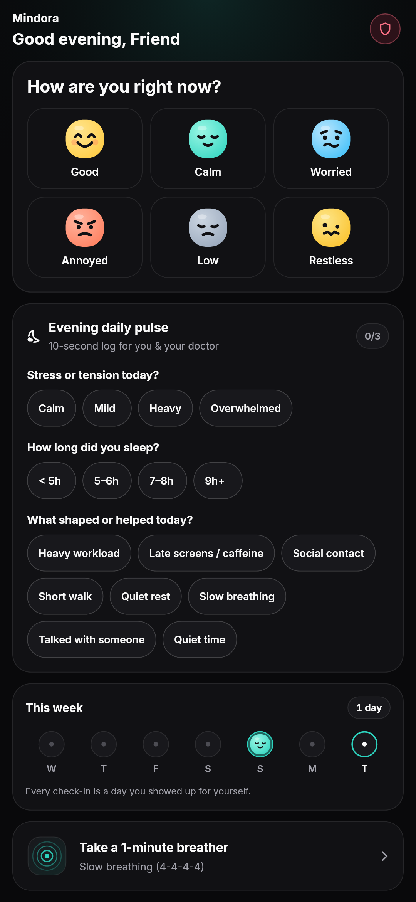
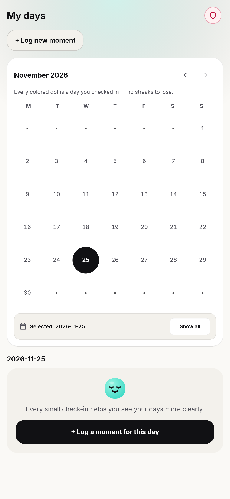
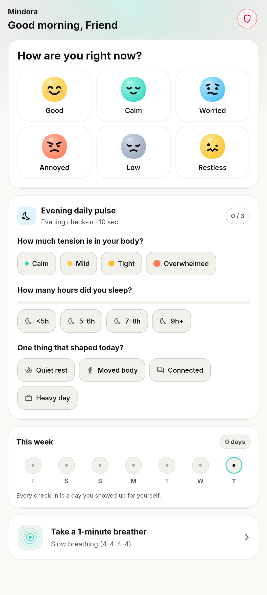
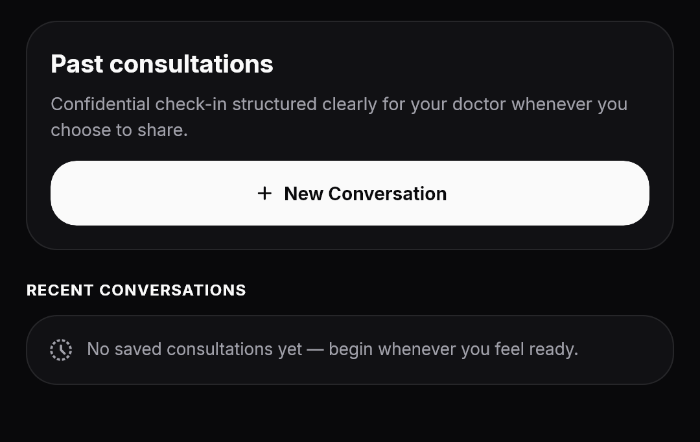
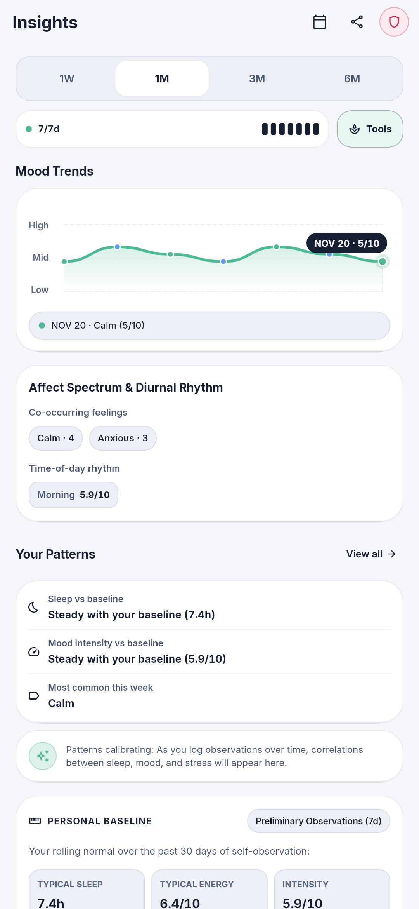

<div align="center">

# Mindora

**Intelligent Mental Health Companion & Cognitive Self-Awareness Platform**

*A privacy-first, low-cognitive-load psychological companion combining fluid somatic tracking, cognitive deconstruction, evidence-based baselines, and crisis safety interception.*

[](https://flutter.dev)
[](https://dart.dev)
[](test/)
[](lib/)
[]()
[-3B82F6?style=flat-square)]()
[](LICENSE)

<br/>



</div>

---

## 🌟 Overview

**Mindora** is an open-source, offline-first cognitive self-awareness and emotional tracking platform. It is engineered with a strict **Options-First, Low-Cognitive-Load** philosophy: users navigating stress, burnout, or emotional fatigue are never confronted with blank compulsory essays or overwhelming choices.

The application combines:
- **Somatic Fluid Visuals:** Mathematical multi-harmonic mood orb with real-time continuous wave dynamics.
- **Cognitive Deconstruction:** Epistemic separation of statements into objective *Facts*, internal *Assumptions*, and emotional *Interpretations*.
- **Authentic Evidence Baselines:** Pure mathematical standard-deviation stability telemetry — never fabricated percentages or synthetic trends.
- **Offline Crisis Interception:** Local regex engine that instantly intercepts acute distress keywords and provides one-tap access to emergency helplines without transmitting data over the network.
- **Unified Design System:** Exact parity across **Dawn Light** (`#F5F6FA`) and **Vercel Dark** (`#000000`).

---

## 📸 Interface Showcase

| **Dawn Light Theme** | **Vercel Dark Theme** |
|:---:|:---:|
|  |  |
| *Airy, soft porcelain background with hairline borders* | *Pitch-black `#000000`, 1px hairline depth, 0% ambient bleed* |

| **Mood Tracking & Somatic Dial** | **Daily Check-in & Notes** |
|:---:|:---:|
|  |  |
| *Continuous harmonic wave orb & tactile intensity (1–10)* | *Options-first emotion library with quick reflection note* |

| **AI Companion & Dialogue** | **Insights & Weekly Rhythm** |
|:---:|:---:|
|  |  |
| *Compassionate reflection with suggested replies* | *Mathematical stability index & Monday-Sunday rhythm* |

---

## 🎨 Design System: Dawn Light & Vercel Dark

Mindora uses a custom **`MindTokens`** theme extension. The system enforces strict token hygiene across all screens with zero hardcoded colors.

### Token Architecture

| Token | Light ("Dawn") | Dark ("Vercel") | Role |
|:---|:---|:---|:---|
| `bg` | `#F5F6FA` | `#000000` | Ground canvas |
| `surface` | `#FFFFFF` | `#0A0A0A` | Elevated cards & sheets |
| `surface2` | `#ECEFF5` | `#111111` | Wells, input fields & tracks |
| `surface3` | `#FFFFFF` | `#1F1F1F` | Active pill & pressed states |
| `line` | `rgba(23, 32, 51, 0.09)` | `rgba(255, 255, 255, 0.10)` | 1px hairline structural border |
| `lineStrong`| `rgba(23, 32, 51, 0.18)` | `rgba(255, 255, 255, 0.20)` | Focused inputs & prominent dividers |
| `ink` | `#172033` | `#EDEDED` | Primary high-contrast typography |
| `ink2` | `#4A5873` | `#A1A1A1` | Secondary descriptive text |
| `ink3` | `#5C6982` | `#8F8F8F` | Helper annotations & timestamps |
| `safety` | `#C0324E` | `#FF6166` | Crisis shield & emergency hotline buttons |

### Dynamic Mood Palettes
Mood accents (`m1` primary, `m2` highlight) drive subtle component highlights (selected borders, slider tracks, spline chart dots, dynamic pills) while maintaining WCAG AA contrast against text:

- **Calm** (`#4FB896` / `#9BE0C6`) — Leaf accent (Default)
- **Anxious** (`#5B9BEA` / `#A0C8FF`) — Flowing wave accent
- **Frustrated** (`#F0805F` / `#FFB894`) — Energetic flame accent
- **Heavy** (`#8A7BE0` / `#BEB0FF`) — Grounded cloud accent
- **Restless** (`#EDB23E` / `#FFD98A`) — Dynamic wind accent

---

## ✨ Core Pillars & Features

### 1. Organic Somatic Mood Orb
- Continuously animated vector fluid canvas powered by pure trigonometric multi-harmonic equations.
- Coupled directly to mood morphology and intensity (1–10).
- Automatically reduces animation velocity and respects `MediaQuery.disableAnimationsOf(context)` for accessibility.

### 2. Forensic Investigation & Epistemic Triage
- Guided cognitive deconstruction workflow inspired by cognitive-behavioral techniques:
  - **Facts:** Objective, observable, verifiable occurrences.
  - **Assumptions:** Presumed intent or unverified anticipations.
  - **Interpretations:** Internal evaluations, meanings, or personal filters.
- Reconstructs cognitive chains: `Trigger` $\rightarrow$ `Automatic Thought` $\rightarrow$ `Emotion` $\rightarrow$ `Behavior`.

### 3. Crisis Safety & Local Protection Interceptor
- Offline regex keyword detection engine analyzes input in real-time on-device.
- Zero network exposure for critical mental safety queries.
- Instant access to emergency helplines:
  - **Tunisia Ligne Verte:** `80 10 50 50`
  - **SAMU (Medical Emergency):** `190`
  - **Protection Civile:** `198`

### 4. Zero-Friction Privacy & Local Vault
- **Local-First Architecture:** Operates seamlessly without requiring account creation or cloud data sharing.
- **Biometric Security (`local_auth`):** Fingerprint and Face ID support for app lock.
- **GDPR-Compliant Clinical Export:** One-tap sanitized JSON export of case sessions or instant local vault purge.

### 5. Trilingual Accessibility (AR / FR / EN)
- **Authentic Tunisian Arabic (`ar`):** Natural colloquial expressions with comprehensive Right-to-Left (RTL) layout geometry and bundled **Noto Sans Arabic** typography.
- **English (`en`) & French (`fr`):** Precise psychological terminology.
- **Typography:** Fully offline bundled **Inter** & **Noto Sans Arabic** (Regular, SemiBold, Bold) fonts with zero Google Fonts runtime network fetching.

---

## 🏗 Tech Stack & Architecture

```
lib/
├── app/
│   ├── localization/      # Trilingual dictionary (EN, FR, AR) & RTL controller
│   ├── router/            # GoRouter configuration & bottom tab navigation
│   └── theme/             # MindTokens, ThemeController & custom ThemeData builders
├── core/
│   ├── safety/            # Offline crisis keywords & emergency interceptor
│   ├── security/          # Biometric lock overlay & encrypted vault
│   └── widgets/           # MindCard, MindButton, OrganicMoodOrb, MindSegmented, etc.
└── features/
    ├── auth/              # Local authentication & anonymous vault
    ├── case_file/         # Case models & clinical JSON export
    ├── home/              # Telemetry dashboard, daily check-in & vagal breathing
    ├── investigation/     # Epistemic triage & forensic chains
    ├── journal/           # Chronological mind traces & searchable logs
    ├── observatory/       # Symptom assessment & perspective explorer
    ├── profile/           # Psychological baseline & condition tracking
    ├── settings/          # Theme toggle (Light/Dark/System), biometrics & language
    └── track/             # Somatic dial, calendar matrix & spline chart
```

- **Framework:** Flutter 3.47+ / Dart 3.13+
- **Architecture:** Feature-first layered architecture with clean domain separation
- **State Management:** Riverpod 3.4+ (`NotifierProvider`, `ConsumerStatefulWidget`)
- **Navigation:** `go_router` 18.1+
- **Local Storage:** `shared_preferences` with in-memory fallback repositories
- **Backend Infrastructure:** Fully decoupled; optional Firebase Spark plan compatible ($0.00 cost)

---

## 🚀 Getting Started

### Prerequisites
- [Flutter SDK](https://docs.flutter.dev/get-started/install) (`>= 3.22.0`)
- Android Studio / VS Code / Xcode
- Git

### Installation & Run

1. **Clone the repository:**
   ```bash
   git clone https://github.com/wacim-abdellli/Mindora.git
   cd Mindora
   ```

2. **Fetch dependencies:**
   ```bash
   flutter pub get
   ```

3. **Verify static analysis:**
   ```bash
   flutter analyze --no-pub
   ```

4. **Run the full test suite (415 passing tests):**
   ```bash
   flutter test
   ```

5. **Launch the application:**
   ```bash
   flutter run
   ```

---

## 🧪 Testing & Verification Matrix

Mindora maintains a comprehensive automated testing pipeline:

| Test Suite | Scope | Status |
|:---|:---|:---:|
| `test/step6_visual_qa_matrix_test.dart` | 35-matrix responsive layout (320px, 360px, 1.35x font, RTL) | Pass |
| `test/theme_tokens_contrast_test.dart` | WCAG AA contrast verification across all token pairs | Pass |
| `test/step2_primitives_test.dart` | Design tokens, button feedback, cards & sheets | Pass |
| `test/accessibility_guidelines_test.dart` | Screen-reader semantics, minimum 48dp touch targets | Pass |
| `test/batch2_wiring_security_test.dart` | Crisis interceptor, biometric lock, local encryption | Pass |

```bash
# Run all tests
flutter test

# Verify zero raw colors across all feature code
Get-ChildItem -Path "lib" -Recurse -Filter *.dart | Select-String -Pattern "Color\(0x|Colors\.(?!transparent)" | Where-Object { $_.Path -notmatch "mind_tokens\.dart" }
# Output: 0 hits
```

---

## ⚖️ Clinical & Ethical Guardrails

- **Educational & Self-Awareness Scope:** Mindora is inspired by cognitive-behavioral principles. It is **not** a licensed medical provider, diagnostic instrument, or a substitute for professional mental healthcare.
- **Strict Anti-Stigma Standard:** The app never predicts relapse, assigns diagnostic labels, or provides weight/diet advice.
- **Emotionally Dignified UI:** Strict zero-emoji policy across all clinical widgets, buttons, and system sheets to preserve dignity and clinical seriousness.
- **Immediate Human Safety Net:** Acute crisis detection triggers an immediate, unblockable prompt to dial local emergency services.

---

## 📄 License

This project is licensed under the MIT License — see the [LICENSE](LICENSE) file for details.

Developed with care by [Wassim Abdelli](https://github.com/wacim-abdellli).
