<div align="center">

# Mindora

**Dual-Workspace Mental Health Sanctuary, Cognitive Deconstruction & Zero-Cloud Clinical Care Loop**

*A privacy-first, options-first psychological platform uniting longitudinal self-observation, forensic cognitive clarity, offline crisis protection, and an encrypted zero-cloud clinician companion workspace.*

[](https://flutter.dev)
[](https://dart.dev)
[](test/)
[](lib/)
[]()
[-3B82F6?style=flat-square)]()
[](LICENSE)

<br/>


</div>

---

## Executive Overview

**Mindora** bridges daily self-observation at home and collaborative psychiatric consultations in-clinic — without forcing either side onto a centralized cloud server.

Built around a strict **Options-First, Low-Cognitive-Load** UX standard, Mindora pairs a calm patient companion (**Patient Sanctuary**) with a dedicated **Psychiatrist Workspace** connected via encrypted, offline in-room QR codes, native printable 1-page A4 consultation briefs, and bidirectional focus plans.

- **Patient Sanctuary:** Multi-moment intra-day mood check-ins, nuanced 2-tier affect taxonomy, optional daily context tags, CBT-inspired cognitive deconstruction (`Fact` / `Assumption` / `Interpretation`), empirical self-stabilizer tracking, and personalized longitudinal pattern baselines.
- **Psychiatrist Workspace:** Adaptive phone + tablet split-pane cohort console (`ClinicianShellScreen`), longitudinal **Since Last Visit** clinical diffs, **Observed Forensic Loop** synthesis, offline EHR clinical note generation, hardware camera QR import (`MF-CLINIC-V1:`), and 1-page monochrome A4 PDF export with native OS share sheet (`MF-CAREPLAN-V1:`).
- **Offline-First & Zero-Cloud Handoff:** Consultation bundles compress (`gzip`), hash (`SHA-256`), and encrypt (`PBKDF2-SHA256` + `AES-256-GCM`) locally on-device using a spoken verbal room PIN.

---

## Dual-Workspace & Zero-Cloud Architecture

```text
+----------------------------------+         In-Room QR / Copy         +--------------------------------------+
|        PATIENT SANCTUARY         |    MF-CLINIC-V1 (Gzip + AES-GCM)   |        PSYCHIATRIST WORKSPACE        |
|                                  |  ===============================> |                                      |
|  * Home + Post-Visit Focus Plan  |                                   |  * Responsive Roster + Split Dossier |
|  * Nuanced Track + Context Tags  |    Bi-Directional Care Focus      |  * Visit-to-Visit Clinical Diff      |
|  * Observed Stabilizers Ledger   |  <=============================== |  * Observed Forensic Loop Map        |
|  * 2-Minute Pre-Visit Brief      |   MF-CAREPLAN-V1 (Gzip + AES-GCM) |  * 1-Page A4 Brief PDF + Share Sheet |
+----------------------------------+        Camera Scan / Paste        +--------------------------------------+
```

### Core Clinical Differentiators (Phases 3–6)

1. **Zero-Cloud Encrypted Care Loop (`MF-CLINIC-V1:` / `MF-CAREPLAN-V1:`):**
   - Patients select exact `ClinicalConsentScope` permissions before generating an encrypted packet or in-room ISO/IEC 18004 QR code (`MindQrCodeEncoder`, Byte-mode Versions 1–40 EC-L).
   - Clinicians scan directly via the in-app camera scanner (`MindQrScannerSheet` + `ClinicHandoffBridge`) or paste from clipboard, inspect longitudinal metrics, and send back structured `PostVisitFocusPlan` action items.
   - `CaseModel.isPrivate == true` investigation records are structurally stripped across every serializer, UI card, EHR plain-text summary, and PDF brief.
2. **2-Minute Pre-Visit Brief & Visit-to-Visit Clinical Diff:**
   - Synthesizes mood/sleep averages, top observed stabilizers, focus plan feedback, and consultation topics (`PreVisitBriefSheet`) before appointment check-in.
   - Automatically archives prior patient packets (`previousPackets`) so psychiatrists see **Since Last Visit** deltas across mood, sleep, energy, anxiety, and evening intensity.
3. **Empirical Recovery Ledger (`ObservedStabilizersCard`):**
   - Computes real within-day peak-to-later-entry calming shifts (`last - earlierPeak`) and co-occurring lower intensity days tied to user actions and protective routines.
4. **Observed Forensic Loop Map (`ForensicLoopMapCard`):**
   - Unifies four non-diagnostic stages into a calm connected vertical rail: **Recurring Context / Trigger -> Diurnal & Affect Pattern -> Observed Thought Chain (`[F]`/`[A]`/`[I]`) -> Observed Stabilizer** across Insights, Clinician Dossier, EHR text (`[3b]`), and A4 PDF output.
5. **1-Page Printable A4 Brief PDF & Native Share Sheet:**
   - Pure-Dart PDF 1.4 (`595x842 pt`, `1240x1754` high-DPI FlateDecode raster) embedding the encrypted QR block at footer right/RTL left, ready for instant local save or native OS print/share via `SharePlus.instance.share`.

### Phase 7 — Effortless Joy & Cross-Generational Comfort (Ages 18 to 80)

1. **2D Tactile `OrganicMoodOrb` Sculpting & `QuickNoteSparksBar`:**
   - Full-LTR/RTL horizontal glide sculpting across intensity (`1–10`) with a 480ms harmonic resonance bloom ring upon logging, paired with 1-tap mood-tailored reflection chips so logging takes 3 seconds without forced typing.
2. **Elder-Friendly Somatic Steppers, 1-Tap Sleep Presets & `CheckInMicroMirror`:**
   - Dedicated `48x48` `-`/`+` precision steppers (`energy_dec`/`energy_inc`, `sleep_dec`/`sleep_inc`, `anxiety_dec`/`anxiety_inc`), 9px tactile slider thumbs, 1-tap sleep preset chips (`<6h`, `7h`, `8h`, `9h+`), and deterministic calm 1-line self-mirrors after logging.
3. **Non-Punitive `DiscoveryMilestonesCard` & Privacy-Safe `MoodAuraPosterSheet`:**
   - 5 strictly cumulative milestones (`First Footprint`, `Nuance Finder`, `Day-to-Night Shift`, `Anchor Found`, `7 Rhythm Days`) that never punish gaps or break "streaks", plus a `1080x1350` offscreen PNG harmonic Mood Aura poster exported without private notes or triggers.
4. **Universal 1-Tap Comfort & Clarity Mode (`DisplayComfortController`):**
   - Toggled from Welcome Step 0 or Settings Group 2 (`mf_display_comfort_v1`) to boost secondary/tertiary ink contrast (`> 7.0:1`), strengthen hairline borders, and gently scale text `+15%` (`1.12x–1.35x` clamped) across both Dawn Light and Vercel Dark.

---

## Visual Quality Assurance Showcase

All screenshots below are rendered in headless Flutter tests using bundled **Inter**, **Noto Sans Arabic**, and **MaterialIcons** font assets across mobile (`412x915`), tablet (`1180x820`), and narrow stress viewports (`320px` + `1.35x` / Comfort `+15%` Arabic RTL).

### Phase 7 — Effortless Joy & 18-to-80 Comfort Showcase

| **Home Tactile Orb & Quick Sparks (Dark EN)** | **Track 48x48 Steppers & Sleep Presets (Light EN)** | **Discovery Milestones 5/5 Unlocked (Dark EN)** |
|:---:|:---:|:---:|
| 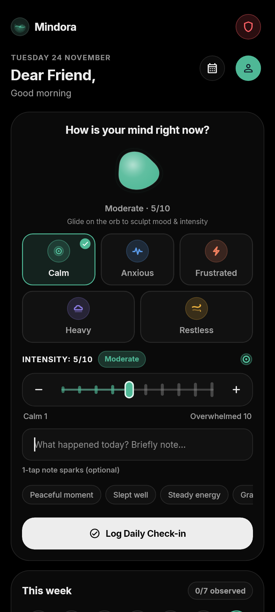 | 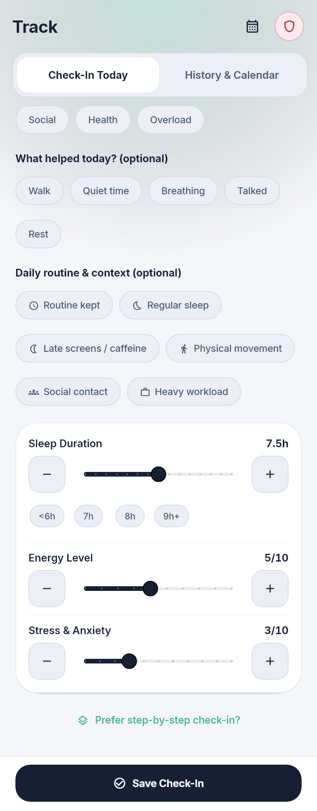 | 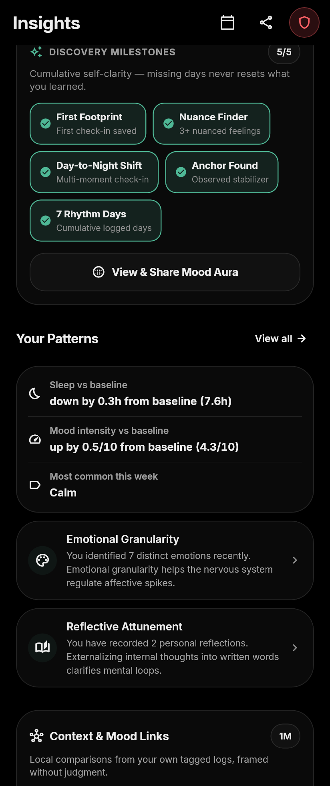 |

| **Generative 1080x1350 Mood Aura Poster (Dark EN)** | **Comfort Mode ON + 320px Arabic RTL (Light AR)** |
|:---:|:---:|
| 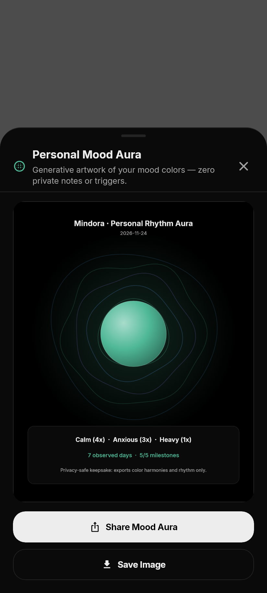 | 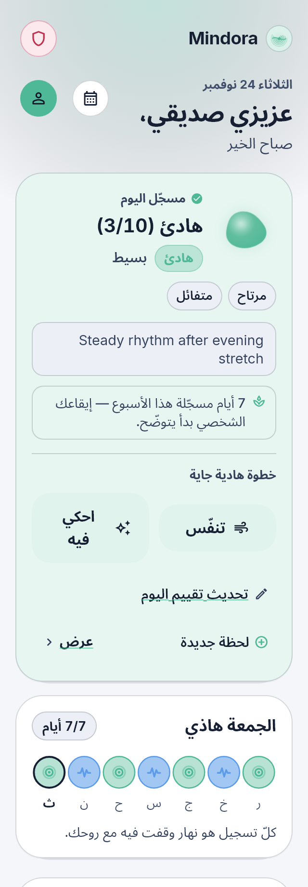 |

### Phase 5 — Differentiator & Launch Proof

| **Patient Insights: Forensic Loop Map (Dark EN)** | **2-Minute Pre-Visit Brief Sheet (Dark EN)** | **Clinician Dossier Loop Map (Dawn Light EN)** |
|:---:|:---:|:---:|
| 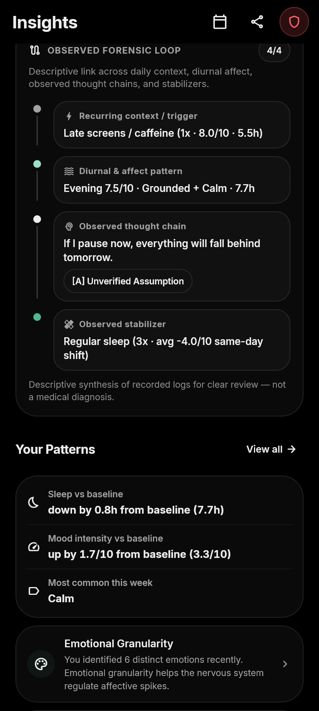 | 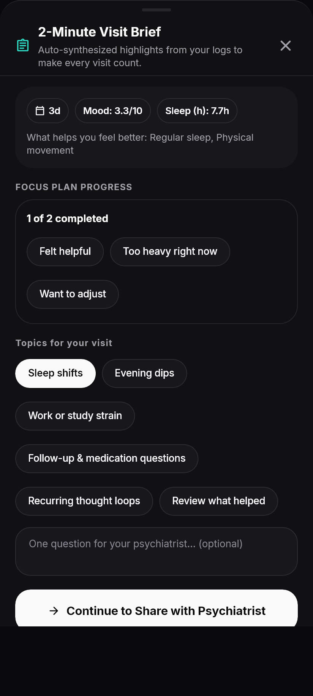 | 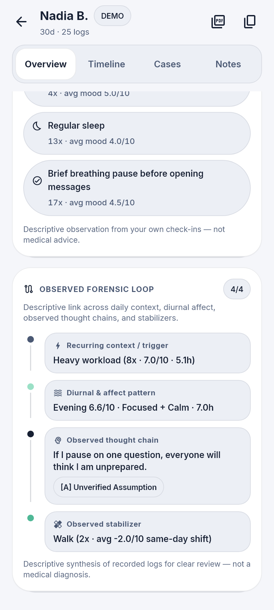 |

| **Printable A4 Clinical Brief + Embedded QR (Dark EN)** | **320px + 1.35x Arabic RTL Stress Test (Dark AR)** |
|:---:|:---:|
| 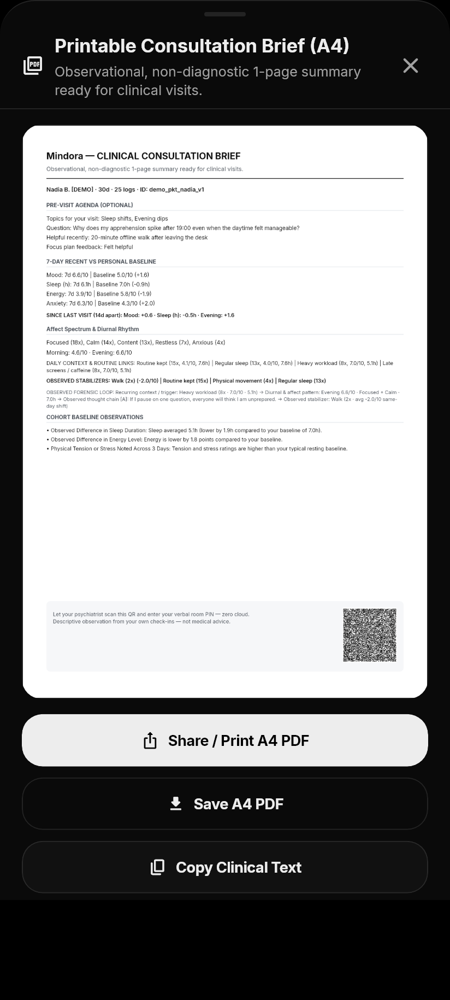 | 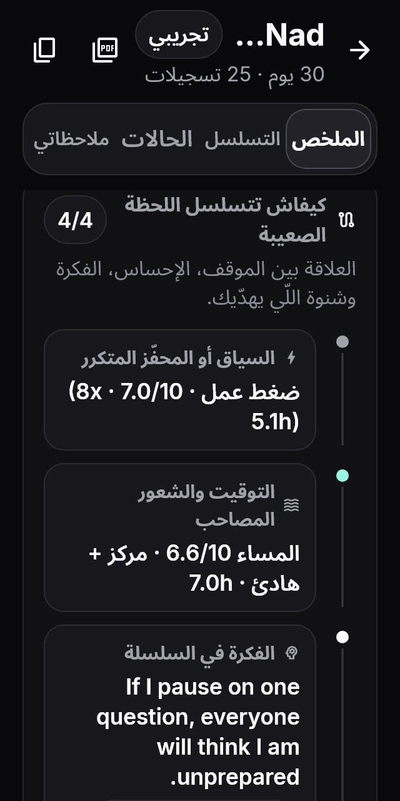 |

### Phase 4 — Dual-Workspace & Adaptive Matrix

| **Home + Post-Visit Focus** | **Nuanced Track + Context Tags** | **Insights Context Correlations** | **Clinician Mobile Roster** |
|:---:|:---:|:---:|:---:|
| 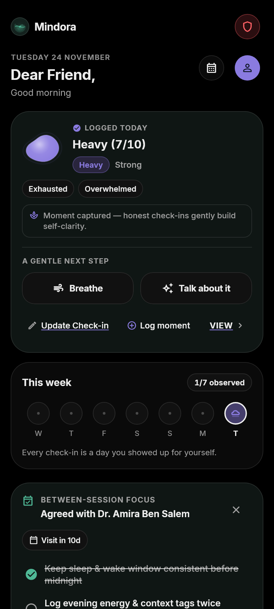 | 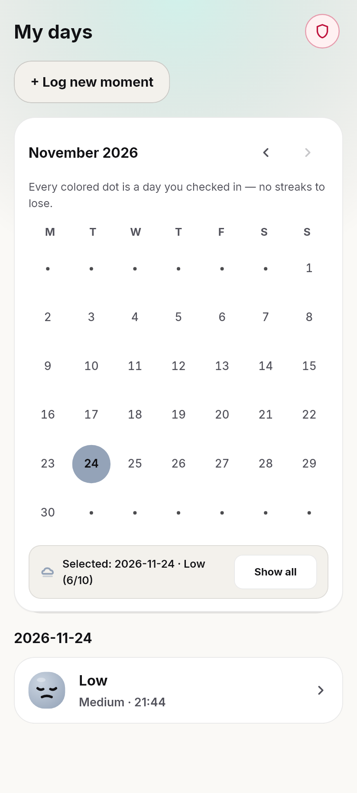 | 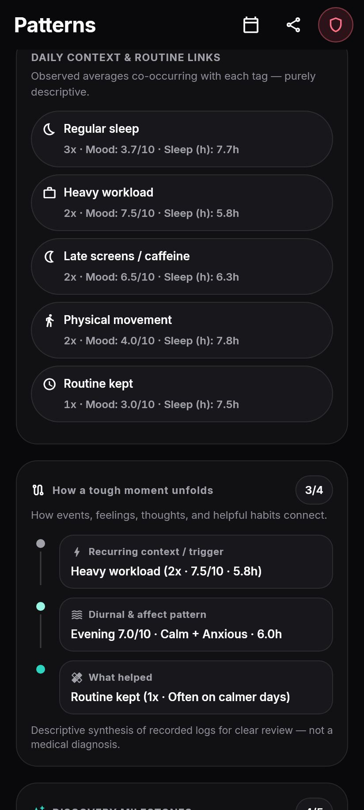 | 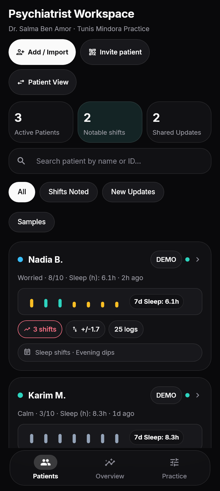 |

| **Clinician Mobile Dossier (Light)** | **Adaptive Tablet Split-Pane (1180x820)** | **320px + 1.35x Arabic RTL Dossier** |
|:---:|:---:|:---:|
| 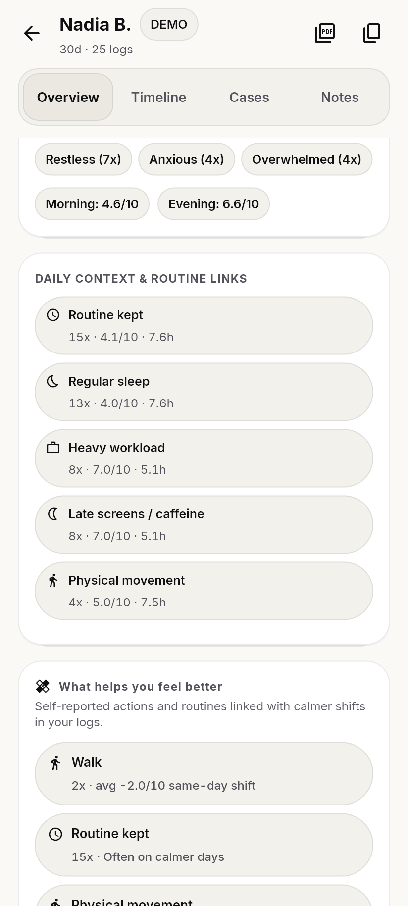 | 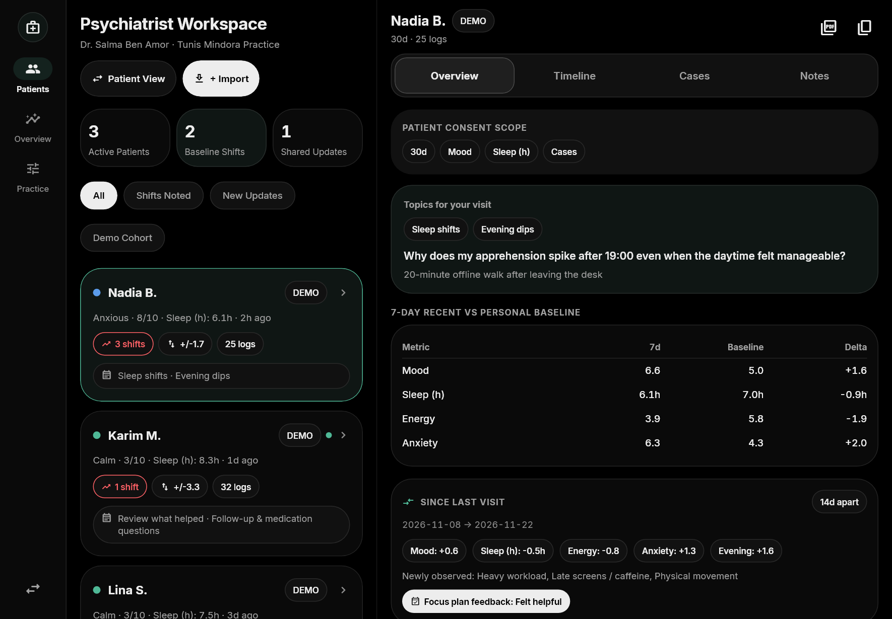 | 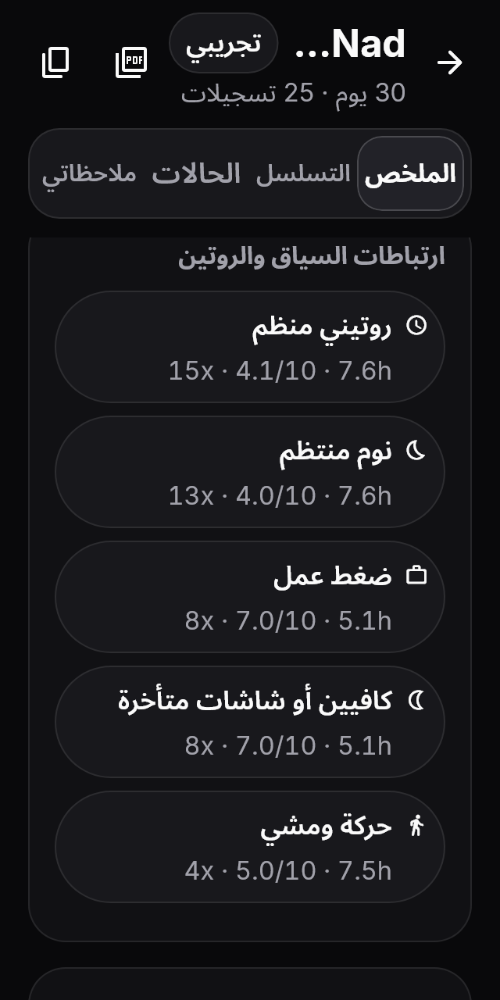 |

---

## Design System: Dawn Light & Vercel Dark

Mindora enforces strict token discipline via **`MindTokens`** (`lib/app/theme/mind_tokens.dart`) with zero raw hex colors in feature UI:

| Token | Light ("Dawn") | Dark ("Vercel") | Role |
|:---|:---|:---|:---|
| `bg` | `#F5F6FA` | `#000000` | Ground canvas |
| `surface` | `#FFFFFF` | `#0A0A0A` | Elevated cards & sheets |
| `surface2` | `#ECEFF5` | `#111111` | Wells, input fields & tracks |
| `line` | `rgba(23, 32, 51, 0.09)` | `rgba(255, 255, 255, 0.10)` | 1px hairline structural border |
| `ink` | `#172033` | `#EDEDED` | Primary typography |
| `ink2` | `#4A5873` | `#A1A1A1` | Secondary descriptive text |
| `safety` | `#C0324E` | `#FF6166` | Crisis shield & emergency hotlines |

---

## Architecture & Repository Layout

```text
docs/
└── PRODUCTION_LAUNCH_CHECKLIST.md   # Pre-user billing/privacy gate & 60s clinic demo script
lib/
├── app/
│   ├── localization/                # Trilingual dictionary (EN, FR, Tunisian AR) & RTL controller
│   ├── router/                      # GoRouter tabs & workspace-aware routes
│   └── theme/                       # MindTokens, lab_colors.dart & Dawn/Vercel ThemeData builders
├── core/
│   ├── notifications/               # Local daily gentle check-in scheduler
│   ├── safety/                      # Offline crisis keywords regex engine & unblockable hotlines
│   ├── security/                    # Biometric lock (local_auth), PBKDF2-SHA256 & AES-GCM cipher
│   └── widgets/                     # MindCard, MindButton, MindQrCodeView, SmoothSplineChart, etc.
└── features/
    ├── auth/                        # Local vault onboarding & anonymous mode
    ├── backup/                      # Password-encrypted offline export/restore
    ├── case_file/                   # Investigation archives & sanitized session exports
    ├── clinician/                   # Psychiatrist Workspace, QR bridge/scanner, A4 PDF, Visit Diff
    ├── home/                        # Daily telemetry dashboard, check-in & post-visit focus card
    ├── insights/                    # PersonalBaseline, Recovery Ledger, Forensic Loop Map, patterns
    ├── investigation/               # Options-first cognitive deconstruction & case repository
    ├── journal/                     # Searchable chronological timeline & reflection entries
    ├── journey/                     # Structured reflective progression modules
    ├── mind_trace/                  # Multi-moment daily mood, 2-tier affect taxonomy & context tags
    ├── observatory/                 # Non-diagnostic symptom log & somatic clarity check-ins
    ├── onboarding/                  # Workspace-first welcome & consent setup
    ├── profile/                     # Personal baseline context & care goals
    ├── settings/                    # Theme switch (Dawn/Vercel/System), language & security lock
    ├── support/                     # Options-first calming & grounding flows
    ├── tools/                       # Future Toolkit v2 placeholder
    └── track/                       # Somatic dial, context chips & intraday timeline
```

- **Framework:** Flutter 3.38+ / Dart 3.10+
- **State Management:** Riverpod 3.3+ (`NotifierProvider`, `AsyncNotifierProvider`)
- **Navigation:** `go_router` 17.5+
- **Hardware Handoff Plugins:** `mobile_scanner` 7.5+ (live QR camera reader), `share_plus` 13.3+ (native A4 PDF share sheet)
- **Storage & Crypto:** `shared_preferences`, `flutter_secure_storage`, `cryptography`, `crypto`, `local_auth`

---

## Getting Started & Verification

```powershell
# 1. Fetch dependencies
flutter pub get

# 2. Static analysis (0 issues required)
flutter analyze --no-pub

# 3. Run full test suite (484 passing tests)
flutter test

# 4. Build debug APK with native share & QR camera plugins
flutter build apk --debug
```

---

## Pre-Launch Gate & Ethical Guardrails

Before onboarding **any** real user or clinic account, teams MUST complete [`docs/PRODUCTION_LAUNCH_CHECKLIST.md`](docs/PRODUCTION_LAUNCH_CHECKLIST.md):

- **AI Billing & Data Protection:** Development runs on the free Firebase Spark tier with `MockInvestigatorService` (`DEV_MOCK_GEMINI_KEY`) as default. Free-tier AI endpoints must NEVER receive real personal data; production launch requires moving to a paid tier with Cloud Billing spend caps and a server-side proxy (`AI_PROXY_URL`).
- **Clinical & Ethical Scope:** Mindora is a reflective self-awareness tool **inspired by CBT** principles. It is not a medical device, never diagnoses, never predicts relapse, and never provides diet/weight/calorie advice.
- **Crisis Safety Net:** Offline regex detection in [`crisis_keywords.dart`](lib/core/safety/crisis_keywords.dart) and [`safety_interceptor.dart`](lib/core/safety/safety_interceptor.dart) surfaces immediate callable emergency support (`80 10 50 50`, `190`, `198`).
- **Clinically Dignified UI:** Strict zero-emoji policy across all application UI widgets, sheets, clinical PDFs, and EHR exports.

---

## License

This project is licensed under the MIT License — see the [LICENSE](LICENSE) file for details.
